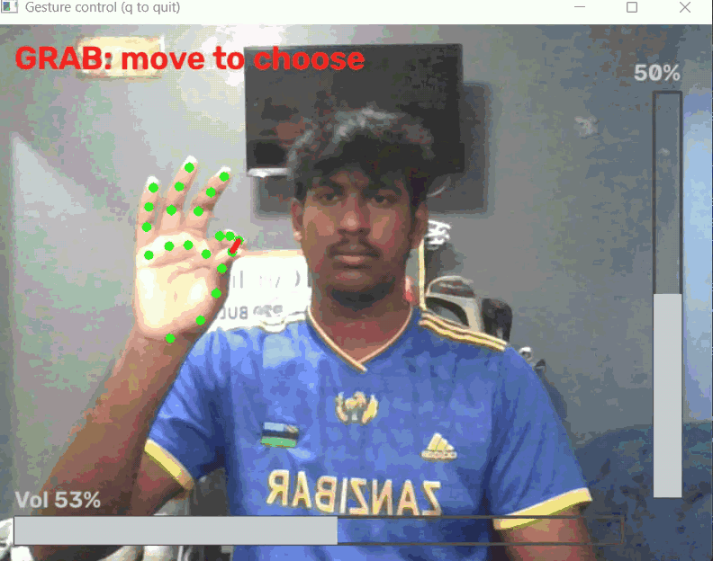

# Gesture Control

Control your laptop's **volume** and **screen brightness** with hand gestures through your webcam.

Pinch your thumb and index finger to grab a virtual slider, then drag:

| Gesture | Action |
|---|---|
| Pinch + drag **up / down** | Brightness up / down |
| Pinch + drag **right / left** | Volume up / down |
| Release pinch | Let go (move your hand back and pinch again to keep going) |


## How it works

1. **Hand tracking**: [MediaPipe Hand Landmarker](https://ai.google.dev/edge/mediapipe/solutions/vision/hand_landmarker) finds 21 landmarks on your hand in every webcam frame.
2. **Pinch detection**: the thumb-to-index distance is divided by the hand's size (wrist to middle knuckle), so it works at any distance from the camera. Separate grab and release thresholds (hysteresis) stop a borderline pinch from flickering on and off.
3. **Drag**: while pinched, the palm's frame-to-frame movement is smoothed and scaled into a percentage change. The axis (horizontal or vertical) locks after the first bit of movement, so you only ever adjust one setting at a time.
4. **System control**: volume is set through the Windows Core Audio API (`pycaw`) and brightness through `screen-brightness-control`. Brightness updates run on a background thread because they're slow, so the camera loop never stutters.

## Requirements

- Windows 10/11
- Python 3.10–3.12
- A webcam

## Setup

```powershell
git clone https://github.com/YOUR_USERNAME/gesture-control.git
cd gesture-control
py -3.12 -m venv .venv
.venv\Scripts\Activate.ps1
python -m pip install -r requirements.txt
```

The hand model (`hand_landmarker.task`) is included in the repo. If it's missing, download it:

```powershell
Invoke-WebRequest -Uri "https://storage.googleapis.com/mediapipe-models/hand_landmarker/hand_landmarker/float16/1/hand_landmarker.task" -OutFile "hand_landmarker.task"
```

## Usage

```powershell
python HandTrack.py
```

A camera window opens showing your hand landmarks, a volume bar along the bottom and a brightness bar on the right. The line between your thumb and index finger turns red while you're grabbing. Press `q` to quit.

## Project structure

| File | Purpose |
|---|---|
| `HandTrack.py` | Main loop: camera, hand tracking, drawing, wiring gestures to controls |
| `continuous_control.py` | `PinchSlider`: pinch detection, axis locking, smoothing, drag-to-delta |
| `controls.py` | `Volume` and `Brightness` wrappers around the Windows APIs |
| `hand_landmarker.task` | MediaPipe hand landmark model |

## Tuning

Pass options to `PinchSlider(...)` in `HandTrack.py`:

| Parameter | Effect |
|---|---|
| `gain` | % change per full frame of movement; higher = more sensitive |
| `accel` | Pointer-style acceleration; fast movements change more (0 = off) |
| `smoothing` | 0–1; higher = steadier but laggier |
| `lock_dist` | How far you move before the axis locks |
| `pinch_on` / `pinch_off` | Pinch ratio thresholds for grabbing / releasing |

## Troubleshooting

- **"Brightness control unavailable"**: your display doesn't expose brightness to software (common with external monitors). Volume still works.
- **Camera won't open**: allow desktop apps under *Settings → Privacy & security → Camera*, and close other apps using the camera.
- **`ModuleNotFoundError`**: the virtual environment isn't active, or packages were installed into a different Python. Activate `.venv` and use `python -m pip install -r requirements.txt`.

## Built with

- [MediaPipe](https://github.com/google-ai-edge/mediapipe)
- [OpenCV](https://opencv.org/)
- [pycaw](https://github.com/AndreMiras/pycaw)
- [screen-brightness-control](https://github.com/Crozzers/screen_brightness_control)
